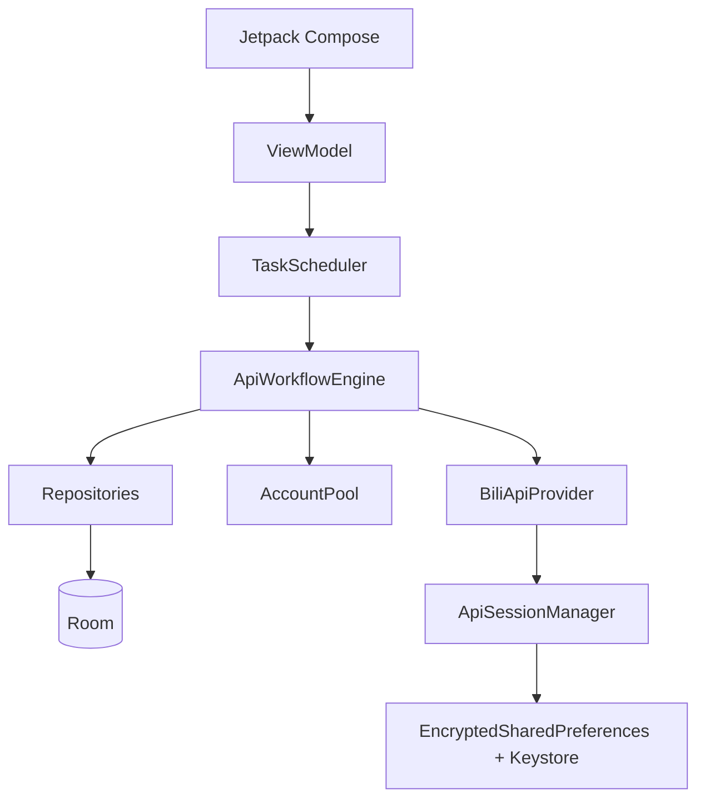

# Bilibili 自动化助手（Android）

Android 端 Bilibili 关注任务助手：扫码登录、账号池、目标 UP、评论遍历与关注执行。正式源码只在 `app/src/**`，用 Kotlin + Jetpack Compose + Room 实现。

当前版本 `0.2.0`，minSdk 26 / targetSdk 36。

> 仅供个人学习与自己账号的辅助使用。请遵守 [哔哩哔哩用户协议](https://www.bilibili.com/blackboard/privacy-tw.html) 与平台规则，不要用于批量养号、绕过风控或未授权操作。

## 能做什么

- **账号管理**：网页二维码登录，头像 / 关注数 / 粉丝数回传，登录失效可对指定账号重扫。
- **账号池**：任务自动占用空闲账号；风控或冷却时轮换到下一个可用号；任务页可手动切换。
- **目标 UP**：搜索并添加 UP，带 Cookie 拉取头像与资料。
- **任务执行**：拉取 UP 视频 → 读评论 → 查关系 → 关注（可 Dry Run）。进度、封面、计数会写入 checkpoint，杀进程后能恢复。
- **状态机**：把「登录失效」和「风控冷却」分开；冷却未到期时重新扫码不会假装成正常号。

## 架构

生产路径走 **Bilibili HTTP API**（OkHttp + WBI），不再用桌面端 Playwright。WebView 只保留给扫码登录和本地自测页。

```text
Compose UI  →  ViewModel  →  TaskScheduler  →  ApiWorkflowEngine
                                                ├→ BiliApiProvider / Session
                                                ├→ AccountPool
                                                └→ Room (账号 / 目标 / 任务 / checkpoint)
```



任务状态：`IDLE → VALIDATE_ACCOUNT → LOAD_VIDEOS → LOAD_COMMENTS → CHECK_RELATIONSHIP → PERFORM_ACTION → … → FINISHED`。会话过期或风控时先校验 nav，再冷却 / 换号或暂停。

## 仓库结构

```text
bilibili自动化/
├── app/src/**                  唯一正式 Android 源码
├── design-reference/ UI/ HTML/  UI 视觉参考（只读，不要改）
├── reference-python-desktop/   旧 Python/PyQt 桌面工程，只参考架构思想
├── docs/                       补充说明（若有）
└── gradle/
```

判断功能是否完成，只看 `app/src/**` 里的 Kotlin，不要用 Python 或 HTML 参考稿当实现证据。

## 环境

- JDK 17（Android Studio JBR 即可）
- Android SDK 36，Gradle Wrapper 8.13
- Kotlin 2.3.0，AGP 8.13.2，Room 2.7.2
- 模拟器或真机；debug 启动 Activity 是 `UiShowcaseActivity`

`local.properties` 不要提交，本机写 SDK 路径：

```properties
sdk.dir=C:\\Users\\<you>\\AppData\\Local\\Android\\Sdk
```

工程目录若含中文，已开启 `android.overridePathCheck=true`。

## 构建

```powershell
$env:JAVA_HOME = "C:\Program Files\Android\Android Studio\jbr"  # 按本机修改
$env:ANDROID_HOME = "$env:LOCALAPPDATA\Android\Sdk"

.\gradlew.bat testDebugUnitTest
.\gradlew.bat assembleDebug
.\gradlew.bat :app:installDebug
```

Debug APK：`app/build/outputs/apk/debug/app-debug.apk`。

Android Studio 里选 **UI Preview**（`UiShowcaseActivity`），不要用旧的 WebView 测试 `MainActivity` 当产品入口。

## 使用流程

1. **账号**：扫码登录至少一个 B 站号。
2. **目标 UP**：搜索 UID / 昵称并添加。
3. **任务**：首页或任务页开始；空闲账号会自动占用。
4. **风控**：当前号冷却后号池自动换号；没有空闲号则暂停，可手动切换或重登。

Cookie 只存在 Keystore 加密存储里，不进 Room。账号状态（正常 / 冷却 / 登录失效）会持久化，短时间重复扫码不会把冷却号刷成「正常」。

## 技术要点

| 层 | 实现 |
| --- | --- |
| UI | Jetpack Compose，debug `ShowcaseRoot` 导航 |
| 任务 | `TaskScheduler` + `ApiWorkflowEngine`，单任务串行 |
| 会话 | `ApiSessionManager` + 每账号 CookieJar |
| 存储 | Room（含任务 checkpoint）+ DataStore 设置 |
| 图片 | `FaceBitmapCache`，B 站 CDN host 回退 |
| 日志 | `AutomationLogger` + 应用内日志页 |

Python 桌面端的 EventBus / Worker / AppState 等概念，在 Android 上分别对应 `SharedFlow` / Coroutine Channel / `UiState`，不要把 PyQt 或 Playwright 代码搬进来。

## 已知边界

- 关注写操作依赖 B 站 `relation/modify`，可能被风控；号池轮换不能绕过平台限制。
- WebView 没有 Playwright 级别的 BrowserContext 隔离，多账号隔离主要靠 Cookie 档案。
- `reference-python-desktop/`、`UI/`、`HTML/` 不是 APK 实现，请勿直接改这些目录来「完成功能」。
